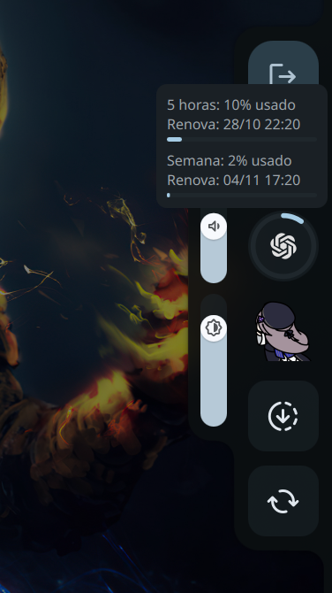

# Caelestia Codex Usage Widget

[Português](#português) · [English](#english)

## Português

Indicador de uso do Codex para o menu de sessão do Caelestia Shell. O anel mostra o uso da janela principal; ao passar o mouse, o painel mostra porcentagens, barras e horários de renovação das janelas principal e semanal. Os dados são atualizados a cada cinco minutos.

### Imagens

<!-- Adicione uma captura em assets/ e insira aqui:  -->


### Requisitos

- Caelestia Shell com o arquivo `~/.config/quickshell/caelestia/modules/session/Content.qml` e uma estrutura compatível com esta personalização.
- Python 3, Codex CLI instalado e autenticado na conta que possui limites disponíveis.
- Tema de ícones Papirus com `/usr/share/icons/Papirus/24x24/panel/indicator-chatgpt.svg`.

### Instalação

```bash
git clone https://github.com/Jorglcs/caelestia-codex-usage-widget.git
cd caelestia-codex-usage-widget
./install.sh
```

O instalador cria um backup de `Content.qml`, insere o widget e copia o script para `~/.local/bin/`. Ele interrompe a instalação se detectar o widget, um script existente ou uma estrutura incompatível. Em seguida, reinicie o Shell em um terminal da sessão gráfica:

```bash
caelestia shell -k
caelestia shell -d
```

Se aparecer “indisponível”, verifique a autenticação do Codex e se a conta fornece limites. O script consulta o `codex app-server` local; não inclui tokens nem envia credenciais a um serviço próprio. A disponibilidade dos dados depende do Codex e da conta.

### Remoção

Restaure o backup `Content.qml.bak-*` criado pelo instalador, remova `~/.local/bin/codex-limits-widget.py` e reinicie o Shell. Se você alterou a configuração após instalar, incorpore essas alterações antes de restaurar o backup.

## English

A Codex usage indicator for the Caelestia Shell session menu. The ring shows primary window usage; on hover, a panel displays percentages, progress bars and reset times for the primary and weekly windows. Data refreshes every five minutes.

### Screenshots

<!-- Add a screenshot to assets/ and insert it here:  -->


### Requirements

- Caelestia Shell with `~/.config/quickshell/caelestia/modules/session/Content.qml` and a layout compatible with this customization.
- Python 3 and the Codex CLI installed and signed in to an account with available limits.
- Papirus icon theme with `/usr/share/icons/Papirus/24x24/panel/indicator-chatgpt.svg`.

### Installation

```bash
git clone https://github.com/Jorglcs/caelestia-codex-usage-widget.git
cd caelestia-codex-usage-widget
./install.sh
```

The installer backs up `Content.qml`, inserts the widget and copies the script to `~/.local/bin/`. It stops if it detects the widget, an existing script or an incompatible layout. Then restart the Shell in a terminal in your graphical session:

```bash
caelestia shell -k
caelestia shell -d
```

If the panel says “indisponível” (unavailable), check Codex authentication and whether your account provides rate limits. The script queries the local `codex app-server`; it contains no tokens and does not send credentials to a separate service. Data availability depends on Codex and the account. The widget labels are currently in Portuguese.

### Removal

Restore the `Content.qml.bak-*` backup created by the installer, remove `~/.local/bin/codex-limits-widget.py`, and restart the Shell. If you changed the configuration after installation, incorporate those changes before restoring the backup.
